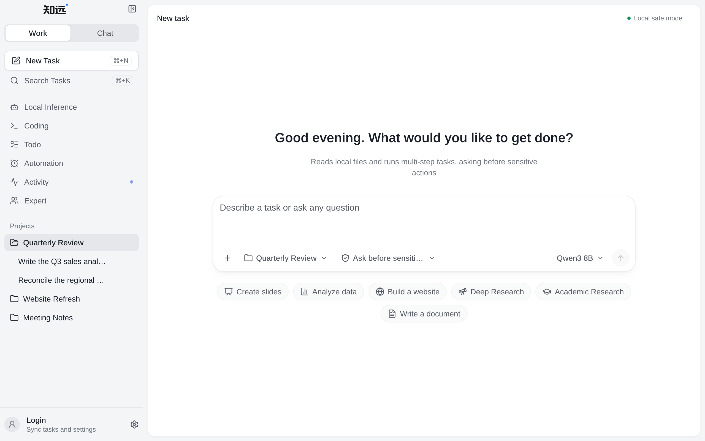
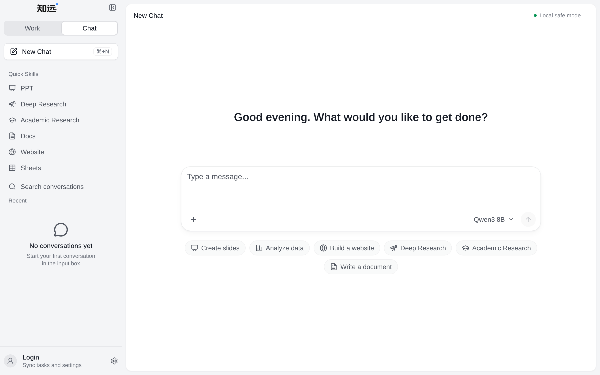

# Creating Your First Work Page

After completing the [Quick Start](./quick-start.md) and configuring a model, you can create your first Work Page.

## Understanding the Work Page

The Work Page is where Seriya starts working. The center of the page is the task input area, where you can select the project the task belongs to, the permission mode (**Ask before sensitive actions** or **Allow all**; the default is **Ask before sensitive actions**), and the model.

## Starting Your First Task

1. Describe what you want to accomplish in the task input area.
2. If the task requires reading or processing files, provide the relevant materials and context first.
3. Confirm the currently selected model and permission mode. For the differences between permission modes, see [Creating and Running Tasks](./tasks.md#permission-modes).
4. Start with a small, clearly scoped task and observe how Seriya executes it.

For example, you can start with a clear small goal: organizing a file, summarizing a set of materials, or generating a first draft from existing content.

## Using Quick Skills

Below the task input area, the Work Page offers quick skill entries such as PPT, Sheets, Website, Deep Research, Academic Research, and Docs.

1. Click a quick skill, for example **PPT**.
2. Describe the content you want to present in the task input area, such as a quarterly work summary, a project report, or a course lecture.
3. Submit the task and wait for Seriya to generate the result.
4. Review the result and continue requesting revisions, adjusting step by step until it meets your expectations.

## Working in Projects

If a task belongs to a project, you can select the project in the input area to keep related tasks and materials in one place. The button to the right of **Projects** in the sidebar creates a project: a new blank project, an existing folder, or no folder. Projects can be pinned, edited, and deleted; when a project is deleted, its chats move back to the chat list.

After completing your first task, you can continue with [Creating and Running Tasks](./tasks.md) and [Adding Files and Context](./context.md).
