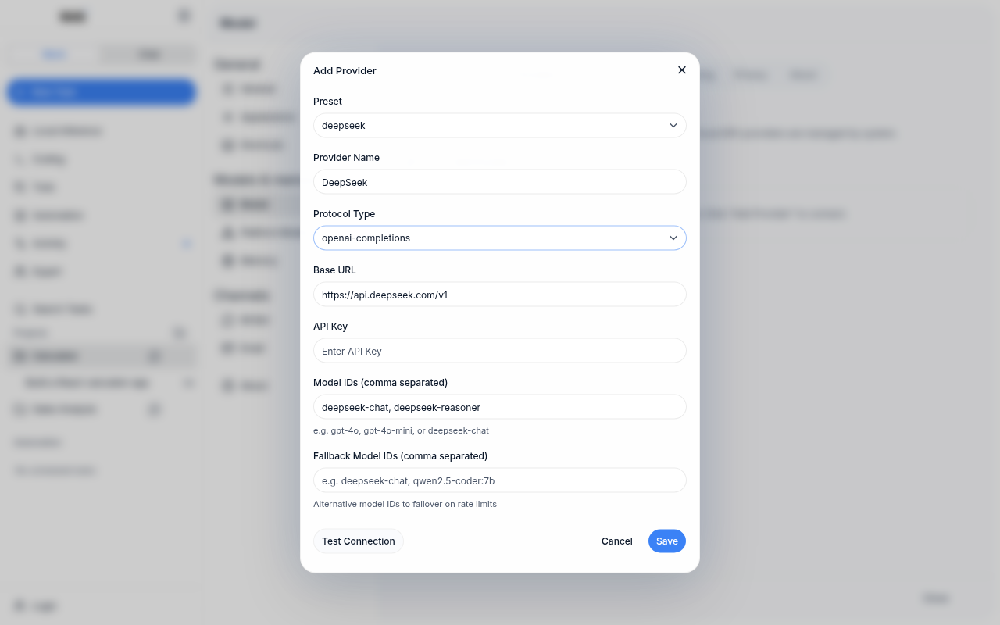

# Using Cloud Models (DeepSeek as an Example)

ZhiYuan can connect to cloud models to process tasks. Cloud models are managed on the **Providers** page under **Settings → Model**. When adding a provider, the **Preset** list offers DeepSeek, OpenAI (Official), Anthropic Native, Google Gemini, Ollama Local, and Custom OpenAI-Compatible. Supported protocol types are OpenAI Chat Completions, Anthropic Messages, and OpenAI Responses.

For services outside the presets, such as Kimi, Qwen, Zhipu, or Doubao, choose **Custom OpenAI-Compatible** and enter the endpoint, API Key, and model names provided by the service.

## Adding DeepSeek

1. Create an API Key on the [DeepSeek Open Platform](https://platform.deepseek.com/api_keys). The API Key is usually only shown in full at creation time; copy and store it immediately.
2. Open **Settings → Model** in ZhiYuan, switch to the **Providers** page, and click **Add Provider**.
3. Select DeepSeek in **Preset**; the provider name, protocol type, endpoint, and model list are filled in automatically.
4. Paste the API Key into **API Key**, click **Test Connection** to confirm it works, and save.

**Fallback Model IDs** can hold alternative models used when the primary model is rate-limited.

## Setting the Default Model

After saving the provider, switch to the **Models** page under **Settings → Model**, refresh the catalog, and select the model to use in **Default model**. New sessions use the default model, and you can switch temporarily in the model selector of the task input area.

After configuration, confirm the model responds normally with a simple task before moving on to complex tasks.
