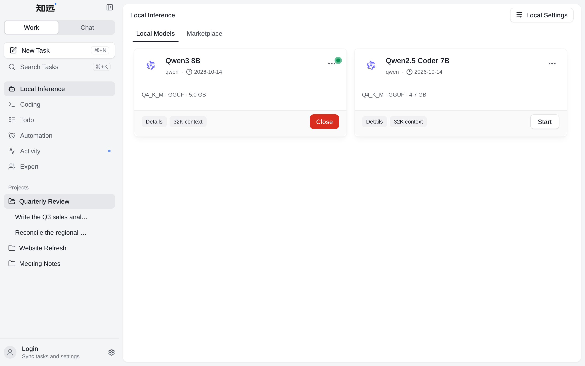

# Using Local Models

Seriya supports installing and using local models. When using local models, the model files, running speed, and the scale of tasks you can handle depend on device resources.

If you are new to local models, it is recommended to first choose a model suitable for your device and check response speed and stability with simple tasks. Go to the marketplace to install a suitable model, then click **Load** on the **Local Models** page. Once loading finishes, the model can be used in tasks. If this page shows **No local models yet**, there are no usable local models yet; install one first. When used for agent tasks, the context length needs to be at least 32K.

Local Inference is available only in the CPU and CUDA editions; the lite edition does not show the **Local Inference** entry.

The specific model list and runtime parameters are subject to the Local Models feature in the app.
