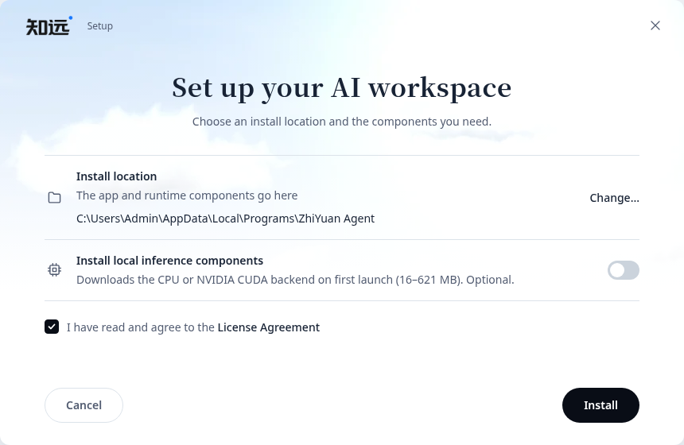
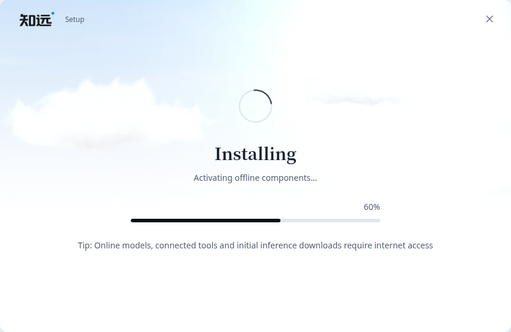

# Quick Start

Seriya is a desktop application. On first use, prepare it in this order: download, install, configure a model, create a Work Page.

## Download

Select the installer matching your system from the [download section on the official website homepage](https://www.rongxzyai.com/#download). The download section reads the latest stable release and provides:

- Windows x64 installers: lite (without local inference), CPU, and CUDA.
- macOS installer (available for both Apple Silicon and Intel).
- Ubuntu x64 `.deb` package.
- x64 AppImage for other Linux distributions.

The version number, file size, and download URLs shown in the download section update automatically with the current stable release. Windows users who need local inference can pick the CPU edition, or the CUDA edition for PCs with an RTX 40-series GPU (with a CPU fallback when the GPU is unavailable), right in the download section; the Linux CUDA edition is under "Release notes". Per-edition installers are available starting with the first release built with edition support. See [Installation and Updates](../faq/install.md) for the differences between editions.

## Installation

After downloading, complete the installation according to your operating system. The installation steps shown by the system vary by installer type.

If the system asks you to confirm the source or permissions, first confirm the installer comes from the Seriya [official website](https://www.rongxzyai.com/), then continue.

## First Launch

The Windows installer has a single page: confirm the install location, check the box to agree to the license, and click **Install**. Keep the **Install local inference components** switch off: the CPU and CUDA editions already include the local inference runtime, and the lite edition does not provide local inference. The installer UI relies on the system WebView2 and prompts you if it is missing.

After installation, launch Seriya and you will see the Work Page. At the top of the sidebar you can switch between the two modes, **Work** and **Chat**: Work mode is for assigning multi-step tasks, and Chat mode is for everyday Q&A. The Work Page includes the task input area, project selection, permission mode, and model selection.

It is recommended to complete the setup in the following order:

1. Confirm the model. Seriya ships with a free model from the "Seriya" provider (**Seriya Free**) that works online without an API Key. The free model has a daily quota; when it is used up, the app asks you to try again the next day. You can also connect a cloud model such as [DeepSeek](./model/cloud.md) in Settings, or [use a local model](./model/local.md).
2. Create a [Work Page](./first-work-page.md).
3. Confirm the model responds normally with a simple task.

After completing these steps, you can continue with [Creating and Running Tasks](./tasks.md).

## Preparation Before Starting

- If using a cloud model, prepare the connection information required by the provider.
- If using a local model, reserve enough disk, memory, and compute resources.
- If processing files, place the relevant materials in the Work Page and confirm the scope of use.

## Troubleshooting

If you cannot install or launch the app, see [Installation and Updates](../faq/install.md) first. If the app opens but the model does not work, see [Model Connection](../faq/model.md).
