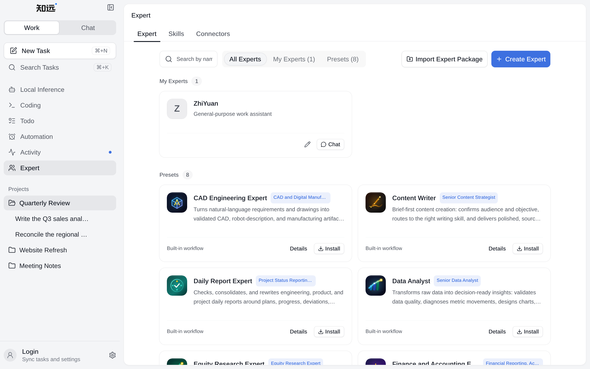

# Using and Managing Skills

Skills are reusable capabilities for specific types of work. ZhiYuan ships with dozens of built-in Skills covering document processing, spreadsheets, research, writing, marketing, and coding.

Skills, Experts, and Connectors are managed together on the **Expert** page in the sidebar, which has three tabs:

- **Expert**: preset agents for professional scenarios. Once installed, you can talk to them directly.
- **Skills**: view installed Skills, or install more from the Marketplace.
- **Connectors**: manage MCP servers that connect external tools and services.

## Experts

An Expert is a combination of Skills, Connectors, and prompts. You can install preset Experts or create a new one: fill in the name, professional role, description, system prompt, and workflow, and attach the Skills and Connectors it needs. Experts can also be imported with **Import Expert Package**.

## Skills

- **Installed**: enable, disable, or uninstall Skills in batch. Built-in key Skills stay enabled.
- **Marketplace**: browse and install Skills from ModelScope, filtered by categories such as Writing, Marketing, Development, Data, Research, Collaboration, Legal, and Search.
- **New Custom Skill**: fill in the Skill Identifier (ID), Skill Display Name, Skill Trigger Description, and specification; you can also ask ZhiYuan in a conversation to create a Skill for you.
- **Remote Import**: enter `owner/repo`, a zip link, or a ModelScope Skill URL to import.

There are three ways to use a Skill in a task: choose it under **Skills** in the "+" menu of the input area, type `/skill` at the beginning of the input box, or click a quick skill in Chat mode.

## Connectors

Connectors are based on the MCP protocol and let ZhiYuan use external tools and services.

- **Marketplace**: provides connectors such as Tavily, GitHub, GitLab, Context7, Google Drive, Gmail, Notion, Slack, Playwright, Canva, Firecrawl, Fetch, and Feishu. Connectors that need authorization are connected by clicking **Connect**. Install the Playwright connector when web operations need to be performed in a browser.
- **Custom**: add MCP servers manually; supported transport types are standard input/output (stdio), server-sent events (SSE), and HTTP streaming. You can also paste an MCP JSON configuration in the Claude Desktop or ZhiYuan format to import, or install from a URL.

To use a connector in a task, choose it under **Connectors** in the "+" menu of the input area.

When using Skills and Connectors, first confirm they fit the current task, then provide the necessary materials and goals. A connector sends the content a task needs to the corresponding service.
