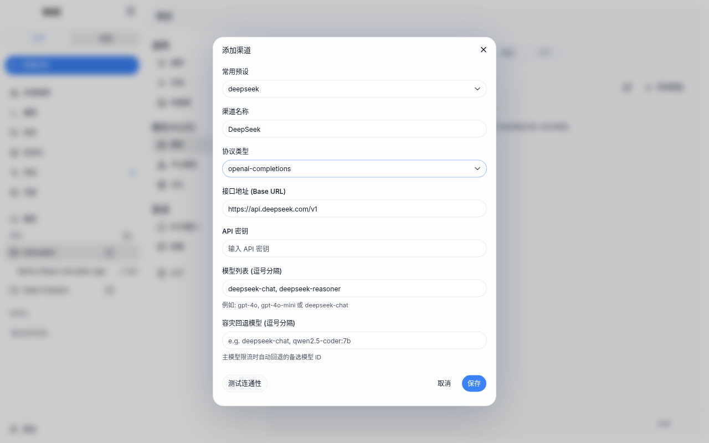

# 使用云端模型（以 DeepSeek 为例）

知远可以连接云端模型来处理任务。云端模型在「设置 → 模型」的「渠道」页管理。添加渠道时，「常用预设」提供 DeepSeek 官方、OpenAI (Official)、Anthropic 官方原生、Google Gemini、Ollama 本地服务和自定义 OpenAI 兼容。协议类型支持 OpenAI Chat Completions、Anthropic Messages 和 OpenAI Responses。

预设之外的服务，例如 Kimi、通义千问、智谱、豆包，选择「自定义 OpenAI 兼容」，填写服务商提供的接口地址、API Key 和模型名称即可。

## 添加 DeepSeek

1. 在 [DeepSeek 开放平台](https://platform.deepseek.com/api_keys)创建 API Key。API Key 通常只在创建时完整显示一次，请立即复制保存。
2. 打开知远的「设置 → 模型」，切换到「渠道」页，点击「添加渠道」。
3. 在「常用预设」中选择 DeepSeek，渠道名称、协议类型、接口地址和模型列表会自动填好。
4. 在「API 密钥」中粘贴 API Key，点击「测试连通性」确认可用后保存。

「容灾回退模型」可以填写主模型限流时使用的备选模型。

## 设置默认模型

渠道保存后，切换到「设置 → 模型」的「模型」页，刷新目录，在「默认模型」中选择要使用的模型。新会话会使用默认模型，也可以在任务输入区的模型选择器中临时切换。

配置完成后，先用一个简单任务确认模型可以正常响应，再开始处理复杂任务。
