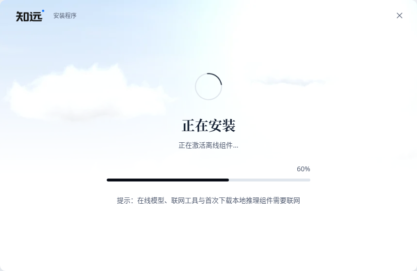
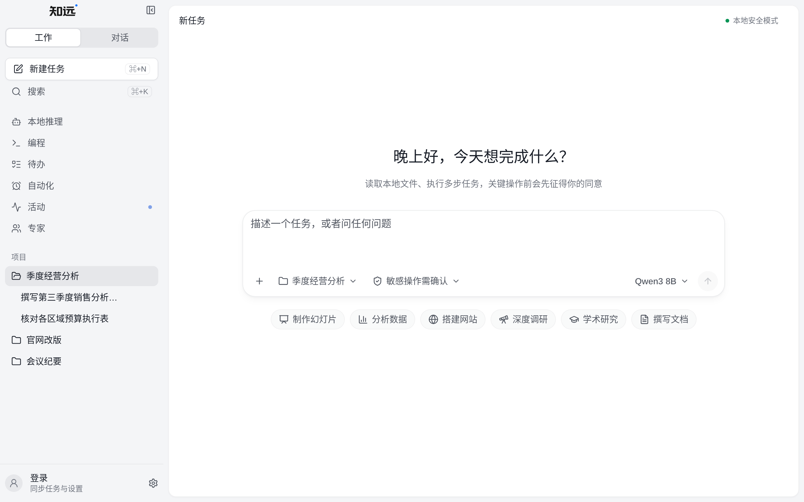

# 快速开始

知远智能体是一款桌面应用。第一次使用时，按“下载、安装、配置模型、创建工作页面”的顺序准备即可。

## 下载

请从[官网首页的下载区域](https://www.rongxzyai.com/#download)选择与你的系统相匹配的安装包。当前下载区会读取最新的稳定版本，并提供：

- Windows x64 安装包：轻量版（不含本地推理）、CPU 版和 CUDA 版。
- macOS 安装包（提供 Apple Silicon 与 Intel 架构）。
- Ubuntu x64 `.deb` 安装包。
- 面向其他 Linux 发行版的 x64 AppImage。

下载区显示的版本号、文件大小和下载地址会随当前稳定版本自动更新。需要本地推理的 Windows 用户可在下载区直接选择 CPU 版，或适用于 RTX 40 系列显卡电脑的 CUDA 版（显卡不可用时回退到 CPU）；Linux CUDA 版在“版本记录”中。按版本分发的安装包从第一个包含多版本构建的发布开始提供。各版本的区别见[安装与更新](../faq/install.md)。

## 安装

下载完成后，按照你的操作系统完成安装。安装包类型不同，系统显示的安装步骤也会不同。

如果系统提示需要确认来源或权限，请先确认安装包来自知远智能体[官网](https://www.rongxzyai.com/)，再继续安装。

## 第一次启动

Windows 安装器只有一页：确认安装位置，勾选同意许可协议，点击「安装」。「安装本地推理组件」开关保持关闭即可：CPU 版和 CUDA 版已内置本地推理运行时，轻量版不提供本地推理。安装界面依赖系统的 WebView2，缺失时安装器会提示。

安装完成后启动知远，会看到工作页面。侧边栏顶部可以切换「工作」和「对话」两种模式：工作模式用于分配多步骤任务，对话模式用于日常问答。工作页面包含任务输入区、项目选择、权限模式和模型选择。

建议按下面的顺序完成准备：

1. 确认模型。知远内置「知远」服务商的免费模型（ZhiYuan Free），联网即可使用，无需 API Key。免费模型有每日额度，用完后应用会提示次日再试。也可以在设置中接入 [DeepSeek](./model/cloud.md) 等云端模型，或[使用本地模型](./model/local.md)。
2. 创建一个[工作页面](./first-work-page.md)。
3. 用一个简单任务确认模型可以正常响应。

完成这些步骤后，就可以继续尝试[创建和执行任务](./tasks.md)。

## 开始前的准备

- 如果使用云端模型，请准备服务商要求的连接信息。
- 如果使用本地模型，请预留足够的磁盘、内存和计算资源。
- 如果要处理文件，请把相关资料放入工作页面，并确认使用范围。

## 遇到问题

如果无法安装或启动，请先查看[安装与更新](../faq/install.md)。如果应用可以打开但模型无法工作，请查看[模型连接](../faq/model.md)。
