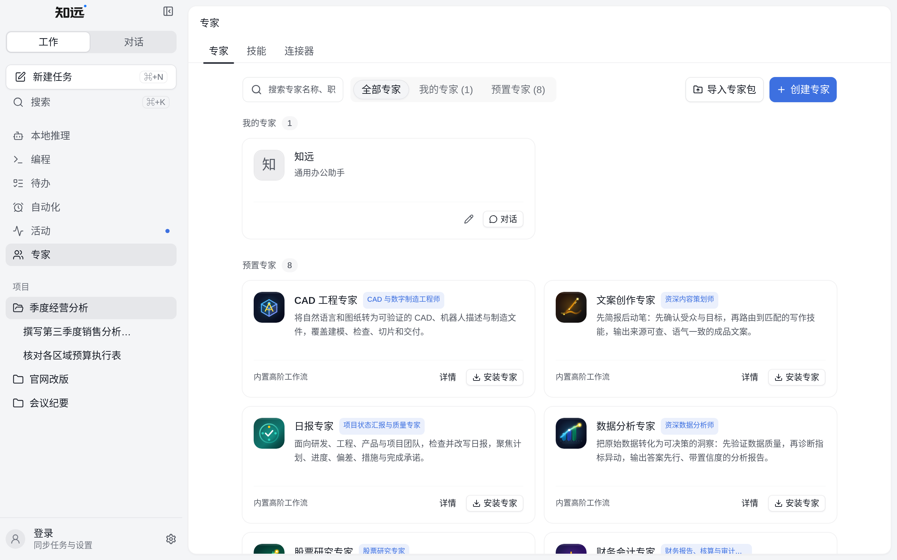

# 使用与管理技能

技能是面向特定工作类型的可复用能力。知远内置数十个技能，覆盖文档处理、表格、研究、写作、营销、编程等方向。

技能与专家、连接器统一在侧边栏的「专家」页面管理，页内分为三个标签：

- **专家**：面向职业场景的预设智能体，安装后可以直接对话。
- **技能**：查看已安装的技能，或从技能市场安装更多技能。
- **连接器**：管理 MCP 服务器，连接外部工具和服务。

## 专家

专家是技能、连接器与提示词的组合。可以安装预置专家，也可以新建专家：填写名称、职业身份、简介、系统提示词与工作流程，并关联需要的技能和连接器。专家也可以通过「导入专家包」导入。

## 技能

- **已安装**：批量启用、停用或卸载技能。内置的关键技能保持启用。
- **技能市场**：从 ModelScope 浏览并安装技能，按写作创作、营销增长、开发工具、数据分析、科研学术、办公协同、法务合规、信息检索等分类筛选。
- **新建自定义技能**：填写技能标识、显示名称、触发描述和规约；也可以在对话中让知远帮你创建技能。
- **远程导入**：输入 `owner/repo`、zip 链接或 ModelScope 技能地址导入。

在任务中使用技能有三种方式：在输入区「+」菜单的「技能」中选择，在输入框开头输入 `/skill`，或在对话模式中点击快捷技能。

## 连接器

连接器基于 MCP 协议，让知远使用外部工具和服务。

- **市场**：提供 Tavily、GitHub、GitLab、Context7、Google Drive、Gmail、Notion、Slack、Playwright、Canva、Firecrawl、Fetch 和飞书等连接器。需要授权的连接器点击「连接」完成授权。需要在浏览器中完成网页操作时，安装 Playwright 连接器。
- **自定义**：手动添加 MCP 服务器，传输类型支持标准输入输出（stdio）、服务器推送事件（SSE）和 HTTP 流式传输；也可以粘贴 Claude Desktop 或知远格式的 MCP JSON 配置导入，或通过 URL 安装。

在任务中使用连接器时，可以在输入区「+」菜单的「连接器」中选择。

使用技能和连接器时，先确认它适合当前任务，再提供必要的资料和目标。连接器会把任务需要的内容发送给对应服务。
