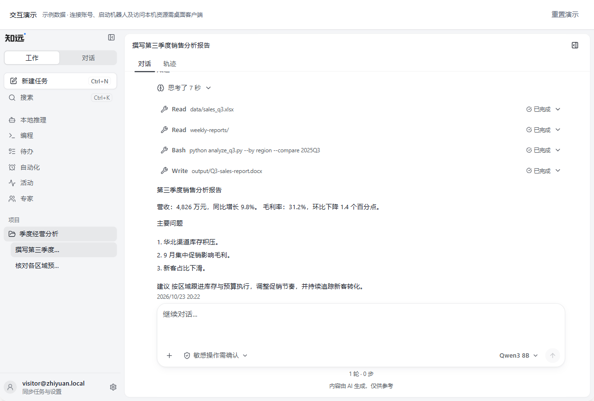
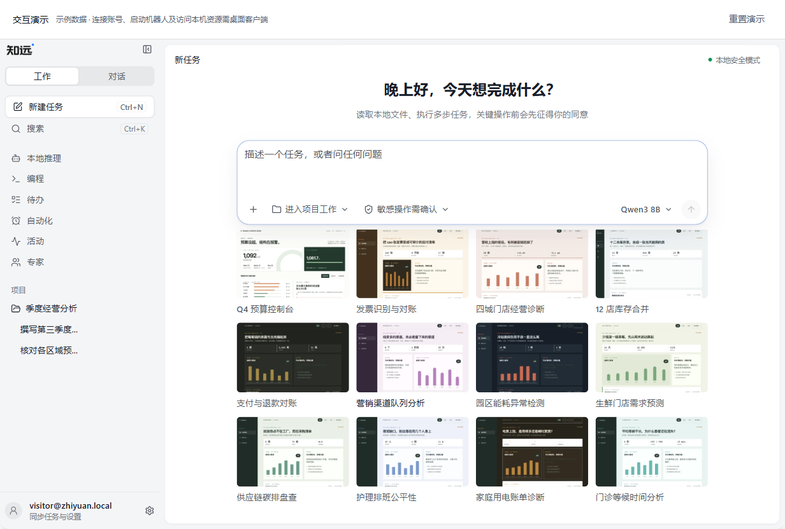

# Live Demo 资源负载对比

测量时间：2026-10-23 20:22（UTC+8）。现有官网 https://www.rongxzyai.com/ 已上线 PR #63 的 Live Demo，本次将它与本地修正版 http://127.0.0.1:5187/ 对比。两者均运行真实客户端；本次修正包括交互边界、模型启停返回结构、非阻断错误处理及案例图片补齐。客户端锁定至 `7a648be8f3562757f14d944c6726ea16bedfe119`，预览专用源码补丁及哈希记录在 `public/client-demo/source.json`。

修正后的资源负载基本持平。新增的 72 张客户端案例缩略图合计 **1.377 MB**，保留原生懒加载；首页、默认示例会话和本次侧栏遍历均未请求这些图片。只有打开案例库才加载相应缩略图。

## 测量结果

以下均为累计值，MB 按 1,000,000 字节计算。“正文”是解压后的响应体积，“传输”是浏览器报告的响应正文与响应头字节数。

| 阶段 | 现有官网请求数 | 修正版请求数 | 现有官网正文 | 修正版正文 | 现有官网传输 | 修正版传输 |
| --- | ---: | ---: | ---: | ---: | ---: | ---: |
| 首页，尚未滚入演示 | 12 | 10 | 0.898 MB | 0.866 MB | 0.411 MB | 0.399 MB |
| 滚入自动启动，客户端就绪 | 68 | 64 | 4.843 MB | 4.810 MB | 1.776 MB | 1.770 MB |
| 遍历六个侧栏页与技能页 | 111 | 107 | 7.638 MB | 7.599 MB | 2.660 MB | 2.697 MB |

本次侧栏依次访问本地推理、编程、待办、自动化、活动、专家及技能页，不包括全部设置、案例库、弹窗或富文本预览。修正版就绪阶段的累计正文比现有官网少约 0.034 MB，差异不到 1%；不能将其解释为显著性能提升。传输体积受 CDN 压缩及响应头影响，遍历阶段本地传输高约 0.036 MB。

修正版各阶段新增正文：

| 类型 | 首页 | 启动客户端新增 | 遍历页面新增 |
| --- | ---: | ---: | ---: |
| HTML | 0.005 MB | 0.001 MB | 0 |
| JavaScript | 0.468 MB | 2.743 MB | 2.662 MB |
| CSS | 0.124 MB | 0.487 MB | 0.001 MB |
| 图片 | 0.140 MB | 0.520 MB | 0.128 MB |
| 字体 | 0.083 MB | 0 | 0 |
| 数据及其他 | 0.046 MB | 0.193 MB | 0 |

## 图片与错误边界

- 构建仅复制原生案例配置引用的 72 张 WebP，共 1,376,578 字节。图片缺失或路径异常会使构建失败。中英文浏览器回归逐项解码全部图片，并打开每类案例的详情，共验证 144 次缩略图解码，未发现 HTTP 错误或破图。
- `public/client-demo/` 共 632 个文件、28.012 MB，包含未访问的预览器、语法、数学、字体和案例图片。这是部署产物大小，不是单次访问下载量。
- 现有官网本次有一个 Cloudflare Insights 脚本请求被 iframe CSP 拒绝，计入请求数、正文为 0；另有一次 HTML 308 跳转，跳转正文不可取得，最终 HTML 已计入。修正版本地无失败请求。请求数差异包含这些部署因素。
- 修正版为 `/client-demo/*` 增加 `Cache-Control: no-transform`，请求 CDN 不向隔离页面注入分析脚本，保留严格的同源 CSP。Cloudflare 上的实际注入行为需在部署后确认。
- 20 秒未就绪改为继续等待并显示重试入口，不再判定致命失败。运行期错误显示非阻断状态；React 根渲染失败和启动失败仍可重试。这些是行为修正，未作为资源体积优化计入。

## 口径与历史基线

使用同一 Chromium 149.0.7827.55、1440×1000 视口、DPR 1、独立浏览器上下文、禁用页面缓存及减少动态效果设置，每站采集一次。等待网络空闲后记录资源，跨 iframe 的请求统一统计。现有官网使用 Brotli/gzip，本地预览记录为 gzip；CDN 缓存、压缩及网络时延会不同。本次没有测量 CPU、堆内存、FPS、首屏时间或真实模型推理性能。

19:22 的历史测量中，尚未上线 Live Demo 的旧官网图集为 26 个请求、2.327 MB 正文、1.001 MB 传输。它不再代表当前线上版本。与该历史图集相比，当前修正版首页正文少约 62.8%，代价是进入真实客户端后下载量更高。历史逐请求记录保存在 [PR #63 版本的报告](https://github.com/rongxinzy/rongxinxzyai-pages/blob/6e11326/reports/live-demo-resource-measurements.json) 中。

## 复现

先运行 `npm run build` 和 `npm run preview -- --port 5187`，再执行：

```sh
node scripts/measure-demo-resources.mjs
npm run demo:verify:resilience
```

脚本复用锁定客户端源码的 Playwright；可用 `ZHIYUAN_CLIENT_SOURCE` 指向同一提交的干净源码，`PLAYWRIGHT_CHROMIUM_EXECUTABLE` 指向现有 Chromium。逐请求 URL、阶段、状态、压缩与体积见 [原始测量](./live-demo-resource-measurements.json)。报告不进入官网文档内容管线。




